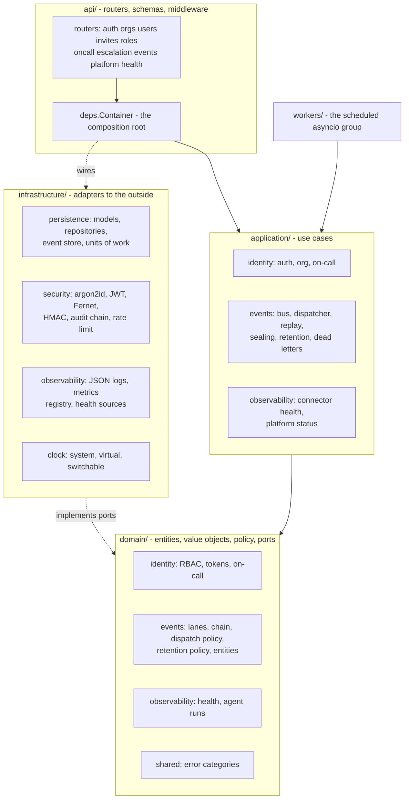
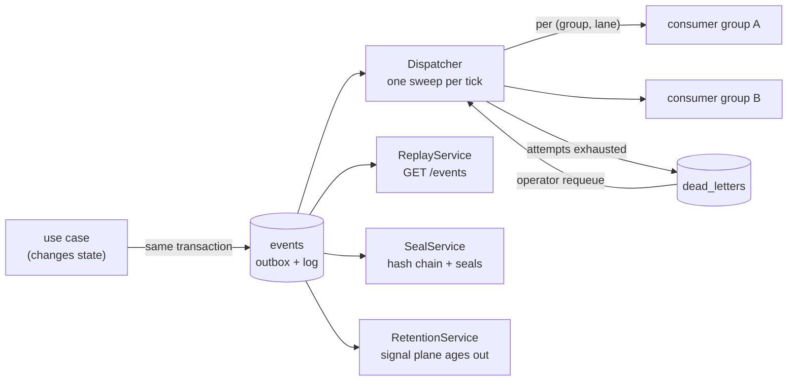

# 07 - Component architecture

Owner: engineering. Status: authored S2-T05; extended each sprint as components land
(adapters S3, detection and lifecycle S4, agents S5, gateway S6, drills S7). Companion
documents: `06-solution-architecture.md` for the system view, `10-data-design.md` for
the schema the components share.

## 1. Layering, and what enforces it

Dependencies point inward. `api` may call `application`, `application` may call
`domain`, and `infrastructure` implements ports the domain declares. Nothing points
back out.

Two rules make this checkable rather than aspirational. `signalforge/tests/
test_repo_layout.py` walks the tree and fails if `domain/` imports FastAPI,
SQLAlchemy or a vendor SDK. `scripts/check_clean.sh` fails if the name of the
reference application appears anywhere outside `reference-app/`, `drills/`, `seeds/`
and tests - the core cannot quietly learn about one particular app.

The composition root is `api/deps.Container`. It is the only place that knows which
implementation backs which port, which is why a test can hand the whole platform a
temporary database and a frozen clock in three lines.

## 2. The event backbone

Everything after Sprint 2 rides on this. It is four cooperating pieces.

### 2.1 Publish is an outbox, not a queue call

`EventBus.publish` takes the caller's unit of work rather than opening its own. The
state change and its event are one commit or neither, so there is no window in which
the platform believes something happened that did not, or vice versa. That is why
`events` lives in the same database as state and why `SqlIdentityUnitOfWork` carries
an `.events` store.

### 2.2 Ordering is per partition, not global

Every event gets a lane from `blake2b(partition_key) % 16`, where the partition key is
the incident, else the app, else the tenant. Each `(group, lane)` pair has its own
stored offset. Two incidents never wait for one another, and a parked event in one
partition does not stop the one behind it in another.

The lane is stored on the row rather than computed on read: Python's `hash()` is salted
per process, so two workers - or one worker after a restart - would disagree, and
disagreement about a lane is silent reordering rather than a visible error.

### 2.3 Delivery is at-least-once, and duplicates are harmless

The handler runs, the `(group, event_id)` ledger row is written and the offset advances
in **one** transaction. A crash before that commit rolls all three back, so the event
is delivered again and the handler runs against unchanged state; a crash after it means
there is nothing to redo. Handlers with effects outside the database get at-least-once
and must carry their own idempotency key - the port says so.

This is the property the sprint acceptance test exercises with a real process kill, not
a simulated exception: `signalforge/tests/events/test_crash_recovery.py` starts a
consuming subprocess, kills it mid-consumption, and asserts nothing was lost, nothing
was applied twice, and order within each partition survived.

### 2.4 Failure has somewhere to go

A failing handler is retried under a bounded policy (default 3 attempts, cap 10 that
configuration cannot raise, exponential backoff). After that the event is parked in
`dead_letters` with its error, an audit entry is written, and the lane advances.

Requeue is a state transition on the dead letter, owned by `DeadLetterService`, not an
instruction to a particular process: the architecture allows splitting api and worker
into two processes, and an api-only node owns no consumer groups at all. The API
records and audits the operator's intent and reports whether the node answering will be
the one to drain it; whichever dispatcher owns the group picks it up on its next sweep.

### 2.5 Two planes, one table

`signal` carries telemetry and ages out on a configured window; `incident` carries what
an incident was and is kept and sealed. Retention is the only code path that removes a
recorded event, and it refuses the incident plane in two independent places. Full
treatment in `10-data-design.md` sections 3 and 4.

## 3. Time

Three clocks, and which one a component holds is a design decision.

| Clock | Read by | Why |
|---|---|---|
| `SystemClock` (wall) | token expiry, refresh windows, rate limits, `recorded_at`, retention cutoffs, offsets | a drill must not be able to expire a session or delete real telemetry early |
| `VirtualClock` | `occurred_at` on drill-emitted events | a drill compresses hours into minutes, and that is genuinely when things happened in the world being simulated |
| `SwitchableClock` | the application layer | points at wall time until a drill installs a virtual clock, and reports which, so the cockpit can show that a timeline is simulated |

`recorded_at` is therefore always wall time and `seq` is always wall order, which is
what keeps replay and the audit trail truthful during a drill.

## 4. Observability

- **Logs.** One JSON line per event, with a request id carried in a context variable so
  a request can be followed through the API, the worker and the bus. The formatter
  redacts known-sensitive keys whatever a caller passes and stringifies values that
  will not serialise, so a log line is never lost to a diagnosis.
- **Metrics.** A small hand-rolled registry rendering Prometheus text. Every metric
  declares its label names, and an undeclared or identifying label is a hard error -
  that is the compensating control that makes an unauthenticated `/metrics` scrape safe,
  and it is asserted in the security suite as well as the unit tests.
- **Health.** `/health` is an unauthenticated readiness probe reporting component
  statuses and nothing that identifies anyone. `/platform/status` is the operator view
  behind `manage_apps`: consumer lag, dead-letter depth, worker job history, clock
  source, retention watermarks.
- **Connector health.** Every source the platform depends on answers the same
  `HealthSource` port with the canonical `HealthReport`, publishes
  `system.connector.health` under the reserved `_platform` tenant, and audits only
  transitions. Sprint 3's adapters register through the same port, which is why the
  integration health screen can list a database and a vendor API side by side.
- **Agent traces.** `agent_runs` and `agent_run_steps` ship empty in Sprint 2 so the
  Sprint 5 agent suite writes into a store that is already tenant-scoped, already in
  the migration history and already readable by the audit surface.

### 4.1 Adapters, and how much an application has to serve

An adapter is a folder with a `manifest.yaml` under
`infrastructure/adapters/`; `builtin.py` maps id to runtime class and is the only file
in the platform that names one. Two families answer the same question at different
prices to the application being onboarded.

| Family | Reads | The application must |
|---|---|---|
| `http-observe-*` (six) | `/observe/*` | implement the frozen observe contract - and get logs, traces, actions and chaos in return |
| `spring-actuator-metrics`, `spring-actuator-health` | `GET /actuator/prometheus`, `GET /actuator/health` | do nothing: a Spring Boot service with Micrometer already serves both |
| vendor adapters (`prometheus`, the webhooks, …) | a vendor API or an inbound post | already exist somewhere in the estate |

The actuator pair is the cheapest onboarding path and the narrowest: metrics and health
only. It exists so that "can SignalForge see this service" and "can this team afford to
change this service" are separate questions. Its two runtimes share
`adapters/probes.py` with the observe health adapter, because a synthetic probe is not
a translation of anything a target publishes - it is SignalForge making a request and
timing it, and two health adapters measuring that differently would report two
latencies for one journey.

## 5. Process model

One process, two asyncio groups, as the solution architecture specifies. The FastAPI
app serves REST (and `/ws` from Sprint 3); `PlatformWorker` owns everything scheduled.
Each job runs its own loop and owns its own failures - a job that raises is recorded
against that job and retried on its next tick, because a broken poller must never stop
incident traffic.

| Job | Interval | Added |
|---|---|---|
| `dispatcher` | 0.5 s | S2 |
| `connector-health` | 30 s | S2 |
| `retention` | 1 h | S2 |

The worker is disabled by configuration on an api-only node, and such a node then does
not claim a worker in its health report rather than reporting a broken one.

## 6. Web

Route files are thin; logic lives in `web/features/<feature>/{components,hooks,api,store}`.
Server code exists only in `app/api` route handlers - the auth cookie proxy, which holds
the tokens so browser JavaScript never does. All data goes through the typed client.

Sprint 2 adds two features. `features/timeline` is the primitive the war room, the
settings screen and the Sprint 7 replay scrubber all reuse: a store that merges by
`event_id` and orders by `seq` (at-least-once reaches the browser too, once replay pages
and the socket both feed it), fixed-height virtualisation so only the rows near the
viewport mount, topic filters and a seq anchor. `features/platform` is screen 21, whose
adapter-registry and ingest sections join the same shell in Sprint 3.

## 7. What each component may assume

| Component | May assume | Must not assume |
|---|---|---|
| A consumer group | events arrive in order per partition, at least once, with the tenant on the envelope | that it sees an event exactly once, or that its own writes are safe outside the given unit of work |
| A use case | publishing an event is atomic with its state change | that a consumer has already run |
| A replay reader | `seq` is a total recording order and the chain verifies against a seal or an anchor | that signal-plane history older than the retention window still exists |
| An adapter (S3) | it answers `HealthSource` and publishes through the bus like everything else | that it can reach the database directly |
| An agent (S5) | its run and steps are traced and budgeted | that it may execute an action without the gateway (S6) |
