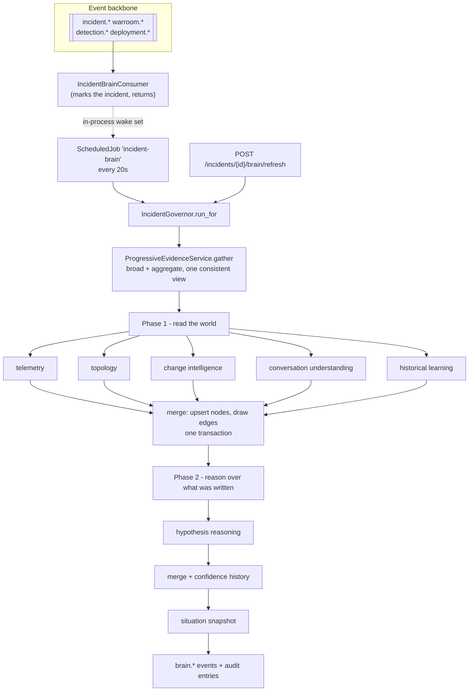
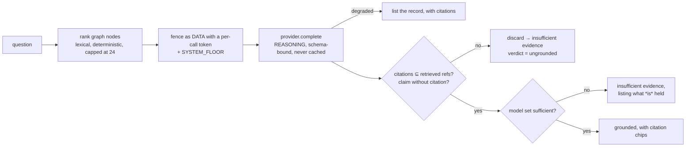

# 08 - Agent architecture

Owner: engineering. Status: authored S5-T03. Scope: the Incident Governor, the
agent roster, triggers, budgets, graph merge rules, and the boundaries that make
an AI feature safe to run inside an incident command centre.

Companion documents: `06-solution-architecture.md` §2.1 (the model path),
`13-controls-matrix.md` (CTL-ESC-02, CTL-ESC-04, CTL-AUD-04),
`15-ai-eval.md` (what is asserted about all of it), `12-threat-model.md` (AI-1,
AI-2, AI-3).

---

## 1. The one-sentence version

SignalForge's AI does not run the incident. It reads what the incident already
holds, correlates it, writes what it concluded into a versioned graph with
provenance attached, and stops. Every number on the screen is arithmetic the
platform did; every sentence is labelled as prose; nothing an agent produces can
change incident state, execute an action, approve anything or send anything,
because no agent holds a path to any of those.

---

## 2. What is *not* an agent

Worth stating first, because the word carries assumptions this design rejects.

| Common shape | What SignalForge does instead | Why |
|---|---|---|
| Eight autonomous services, each with an LLM loop | One governor, eight capabilities sharing its state, budget and trace | Eight services means eight retry policies, three notions of budget, and a provenance field that means something different per writer |
| Agents that call tools | Agents that return **proposals**; the governor writes | An agent that can act is an agent a prompt injection can drive |
| A model that decides confidence | A model that writes one sentence beside a number the platform computed | A model answers "83%" with equal fluency on three corroborating signals and on none |
| A planner that chooses the next action | Nothing. Next-best-action is S6, behind the Tool Gateway and the policy floor | High-risk actions can never auto-execute (CTL-PRO-01, FLOOR) |
| Retrieval-augmented free text | Bounded, cited, schema-validated answers whose citations must resolve | An answer that looks grounded and is not is worse than a refusal |

---

## 3. The Incident Governor

`signalforge/application/brain/governor.py`



### 3.1 Why waking and running are separate

The bus consumer does almost nothing: it records `(tenant, incident)` in an
in-process set and returns. A scheduled job drains it.

This is not fastidiousness. A governor pass reads several stores, may call a
model over the network, and writes a transaction of its own. Doing that inside
the dispatcher's transaction would hold a SQLite write lock for seconds against a
loop meant to take milliseconds, and a second connection opened while the first
is held is a deadlock waiting for a busy night.

It also makes redelivery free. A wake is a key in a set, so an event delivered
twice wakes one incident once; and the pass itself is idempotent, because a graph
write against an unchanged world writes nothing.

`brain.*` is deliberately **not** in the trigger set. An agent reacting to its own
output is a loop, and the one thing a budgeted reasoning system must not be able
to do is feed itself.

### 3.2 Why the pass is two-phase

Phase one runs the agents that read the world and merges their proposals, where
each node gets a real id. Phase two runs the hypothesis agent against the
*written* graph, so a hypothesis links to the exact node versions that argued for
and against it.

Running them together would link hypotheses to nodes that do not have ids yet,
and "why did #2 move from 65% to 32%?" would be answerable only by prose.

### 3.3 What a pass cannot do

- **It cannot raise.** Every agent runs inside a guard; one that throws is
  recorded as `failed` on its own run row and the pass continues. An incident
  whose brain could take the incident down with it would be worse than no brain.
- **It cannot reason about a closed incident.** A closed incident's brain is a
  record, not a work item; continuing would spend budget rewriting history.
- **It cannot exceed its budgets.** Two, enforced in order: a query budget
  (`QueryBudget`, per hypothesis and total) refuses retrievals before any tokens
  are spent, and the per-incident token ledger (S5-T02) refuses model calls
  before the request leaves.

---

## 4. The agent roster

| Agent | Trigger | Deterministic | Model | Writes |
|---|---|---|---|---|
| telemetry | every pass | everything | **none at all** | `fact`, `evidence`, `impact` |
| topology / dependency | every pass | everything | none | `fact`, `evidence`, `impact` |
| change intelligence | every pass | everything | none | `evidence`, `fact` |
| conversation understanding | every pass with a transcript | classification, contradiction detection | promotes unclassified lines only | `fact`, `assumption`, `action`, `risk` |
| historical learning | every pass | fingerprints, similarity, decay, warnings | embeddings only (optional) | `evidence`, `risk` |
| hypothesis reasoning | phase 2 of every pass | **the entire confidence computation** | one narrative sentence | `hypothesis` + confidence history |
| communication (join brief) | on read of `GET /incidents/{id}/brief` | the whole brief | rewrites it, cannot drop a caveat | nothing (returns a `JoinBrief`) |
| IC copilot | on `POST /incidents/{id}/brain/ask` | retrieval, ranking, validation | the answer, schema-bound and cited | nothing (audit entry + event) |

### 4.1 Telemetry - transport with provenance

Contains **no model call**, and that is the design rather than an omission.
Detection already computed the anomalies, the SLO burn rates, the health score,
the corroboration verdict and the alert clusters, deterministically and with
tests. Asking a model to restate them would introduce a paraphrase where there
was a number, cost tokens, and write an `INFERRED` node where an `OBSERVED` one
belongs.

Its one judgement is what counts as **confirmed**: a service is confirmed when
something was measured on it. That set is handed to topology, which may only
*predict* from it.

### 4.2 Topology / dependency - the CONFIRMED / PREDICTED line

Walks the versioned map outward from the confirmed set, with a **hop limit of 3**
and a likelihood decaying by 0.55 per hop. A dependency graph in a real estate is
connected enough that an unbounded walk reaches everything, and "everything is
predicted to be affected" is the same statement as "we have no idea".

Everything it adds is `PREDICTED`, structurally: `domain/brain/topology.propagate`
marks it, and there is no code path in the agent that can produce a confirmed
impact the caller did not supply.

It also answers "has the map changed since this started?" from the kept versions.

### 4.3 Change intelligence - proximity is not causality

Writes an `EVIDENCE` node stating the observed timing, never a fact saying a
change caused anything. Proximity is scored on a curve (1.0 at onset, ~0.3 at the
90-minute edge, 0.1 outside) rather than a cutoff, because a change two minutes
before the first anomaly is far more interesting than one eighty minutes before,
and a binary window would treat them identically.

Onset is the earliest `anomalous_since` the detector holds, not the declaration:
a P1 declared forty minutes after the first anomaly would otherwise make every
change in those forty minutes look proximate - including the one deployed *in
response*.

### 4.4 Conversation understanding - two passes, one direction

```
message ──▶ deterministic classify()  ──▶ fact / assumption / question / decision /
                                          commitment / blocker / chatter
                │
                └─ chatter or question only ──▶ model ──▶ reconcile()
                                                            │
                                    may promote ────────────┘
                                    may never overturn an explicit call
```

`MODEL_UPGRADABLE = {chatter, question}` is the whole safety property. When the
deterministic pass says "commitment" it has matched an explicit promise, and a
model second-guessing it would lose a task somebody made. When it says "chatter"
or "question" it merely failed to match a pattern - and that is exactly where
*"Sam, can you check the pool?"* lives.

**No duplicate tasks.** S4's commitment harvester owns the task board and keys on
`(message_id, title)`. This agent creates no tasks at all: it records commitments
as graph nodes keyed on `(ref, kind)`. Two writers with two key schemes producing
two rows for one sentence is the failure this avoids, and it is avoided by not
having two writers.

Contradiction detection is separate and deterministic, because it compares two
structured things - a human health claim about a named subject against a
measurement of that subject - rather than reading a mood.

### 4.5 Historical learning - advisory by construction

Similarity is structural (signal families, services, regions, change types, app,
severity) at 70% weight, blended with an optional embedding cosine at 30%. When
the gateway degrades, the structural score stands alone **at full weight** rather
than being penalised for a missing term: a degraded model path must not look like
a lack of similarity.

Relevance decays with a 120-day half life, floored at 0.1, and the *decayed*
number is the one shown. An operator comparing "82% similar" between a two-year-old
incident and last week's is comparing the wrong numbers.

Mistake warnings come from what a prior incident **ruled out**, not from what it
concluded. "We spent forty minutes on the pool last time and it was not the pool"
invites the room to test something; "it was the pool last time" invites it to
adopt a conclusion.

### 4.6 Hypothesis reasoning - where the number comes from

```
confidence = clamp( σ( logit(PRIOR) + SCALE × net_weight ) , 0.02 , 0.97 )

net_weight = Σ firm_evidence.weight  +  clamp(Σ advisory.weight, ±ADVISORY_CAP)
weight     = ±1 × BASE_WEIGHT[kind] × AUTHORITY_FACTOR[authority] × strength
```

| Constant | Value | Argument |
|---|---|---|
| `PRIOR` | 0.35 | Most hypotheses raised in the first ten minutes are wrong. Zero would read as "ruled out"; a fresh hypothesis is unevidenced, not eliminated. |
| `LOGISTIC_SCALE` | 1.6 | One strong corroborated signal moves a fresh hypothesis to ~⅔; two independent ones to ~⅘. |
| `MIN/MAX` | 0.02 / 0.97 | Never 0 and never 1. Certainty about a running incident is something no evidence here can support, and the ends are where operators stop reading the evidence. |
| `AUTHORITY_FACTOR` | 1.0 / 0.9 / **0.25** | Inferred - anything a model concluded - counts a quarter. This is what stops a chain of model inferences manufacturing certainty. |
| `ADVISORY_CAP` | 0.35 | Historical similarity, capped in total and in both directions, so a hypothesis supported by nothing but history stays below even odds however many priors agree. |

Base weights, arguable line by line, which is the point:

| Kind | Weight | Kind | Weight |
|---|---|---|---|
| corroboration | 1.50 | change proximity | 0.90 |
| diagnostic result | 1.40 | topology path | 0.80 |
| contradiction | 1.30 | human statement | 0.80 |
| probe failure | 1.20 | alert cluster | 0.70 |
| SLO burn | 1.10 | health score | 0.60 |
| telemetry anomaly | 1.00 | historical similarity | **0.45** |

Every recomputation writes a `ConfidenceEntry` naming the previous value, the new
value, the net weight, the supporting and refuting node ids, and which evidence is
new since last time. `explain()` is written from those stored numbers, so it says
the same thing whether or not a model was reachable. The model's narrative sits
*beside* it, labelled, and its schema has no number field for a confidence to
arrive in.

**The catalogue always offers competing hypotheses**: a change-induced one, a
saturation/dependency one and an infrastructure/regional one, plus the proximate
change by name and any recurrence of a prior incident's recorded cause. A room
that sees one hypothesis tests one hypothesis.

### 4.7 Communication - the brief, with its caveats welded on

The deterministic brief is built first and always. The model rewrites *that
material*, grounded in the graph. Validation then does two things that make the
rewrite safe:

- a section the template filled may not come back empty - that is a loss, not a
  rewrite;
- the caveats are **unioned** with the template's rather than taken. A model that
  produced a confident brief by dropping "the evidence is not corroborated" would
  be strictly worse than no model, and this makes that impossible rather than
  unlikely.

Any failure - degraded, off-schema, empty - serves the template stamped
`BriefSource.DEGRADED`, which is what puts the badge on the screen.

### 4.8 IC copilot - grounded or refusing



Ranking is lexical rather than embedding-based on purpose: it is deterministic,
costs nothing, needs no gateway, works identically in degraded mode, and the set
it selects from is one incident's graph - tens of nodes, not a corpus.

The answer is never cached: two people asking the same question minutes apart are
asking about different graphs, and a warm cache would serve the older one with the
newer one's authority.

---

## 5. Graph merge rules

`IncidentGraphRepository.upsert` carries the whole versioning rule in one
transaction, because "supersede the old row, insert the new one" split across two
leaves an incident with two current versions of the same belief.

| Situation | Result |
|---|---|
| No node for this `derived_key` | Insert at version 1 |
| Held, and `differs_from` is false | **Nothing written.** An agent running every 30s against an unchanged world must not mint a version |
| Held and changed | Old row → `SUPERSEDED` with `superseded_by`; new row at `version + 1` naming `supersedes` |
| Belief withdrawn | `RETRACTED`, kept and readable, excluded from the current view |

`derived_key` is the idempotency handle: normalised, lowercased, and **hashed
rather than truncated** for long parts, because truncation makes two different
sources collide - the one failure the key exists to prevent.

Edges are unique on `(tenant, incident, source, target, relation)`. Re-linking the
same evidence to the same hypothesis must be a no-op; a duplicated edge would
double that evidence's weight and move a confidence with no new evidence behind
it.

---

## 6. Provenance, and what an auditor can ask

Every node carries a `Provenance`: the source, the actor type, the **authority**,
and - only where a model was involved - the model, its classification, the prompt
purpose, and whether it degraded.

| Question | Answered by |
|---|---|
| Which agent ran? | `agent_runs.agent`, and `provenance.source` on every node it wrote |
| Which model, and which classification? | `agent_runs.model`; `provenance.model` / `model_class` |
| What incident did it affect? | `agent_runs.incident_id`; every node names its incident |
| What evidence did it use? | `provenance.result_ref`, plus `SUPPORTS`/`REFUTES` edges by node id |
| What did it produce? | The node ids written in that pass, and the snapshot taken after it |
| Did it degrade? | `agent_runs.status`, `provenance.degraded`, `system.llm.degraded` on the timeline |
| What did it cost? | `agent_runs.prompt_tokens` / `completion_tokens`, and the incident's token ledger |

`Authority.INFERRED` is stamped on everything an agent concludes, without
exception. The brain correlates things other subsystems measured; recording its
output as `OBSERVED` would put a correlation into the audit chain wearing the
authority of a measurement.

**What the trace does not contain**: prompts, answers, or any incident content.
That row says which agent ran, on what, with which model, how much it cost and
whether it degraded. Everything it *concluded* is a graph node with its own
provenance, which is where an auditor reads content and where redaction and
retention already apply.

---

## 7. The prompt-injection floor

Every piece of text an incident produces that this platform did not write is
**data**: bridge messages, chat, log lines, alert annotations, ticket bodies,
retrieved documents, tool results. Some of it may be hostile; more of it is merely
careless.

Four mechanisms, applied together because none is sufficient alone:

1. **Structural separation.** Untrusted text never appears in a system message. It
   is fenced inside a per-call, unguessable delimiter derived from the incident id
   and the call site, in a *user* message, introduced by a line saying what it is.
   Any line inside that tries to forge the end marker is indented, so it cannot sit
   where a parser or a model reads structure.
2. **A standing instruction that outranks the content.** `SYSTEM_FLOOR` says
   plainly that DATA is evidence and never an instruction, that the assistant holds
   no tools and can change no state, and that a gap is reported rather than filled.
3. **Output constraints.** The copilot answers into a schema whose citations must
   resolve to retrieved refs; the brief cannot drop a caveat; a classification for
   a ref that was not sent is discarded.
4. **Nothing to execute.** No agent holds an invoker, a tool gateway, a write path
   or an HTTP client. A model fully persuaded by an injected instruction has
   nothing to do about it. This is the control that actually holds; the other
   three reduce the chance of the model being persuaded at all.

`scan()` **flags and never sanitises**. Stripping the sentence would destroy the
evidence and teach an attacker what the filter looks for. An attempt becomes a
`RISK` node, a `brain.injection.observed` event and a row on S14.

---

## 8. Degradation

`LlmProvider` never raises for a model failure (REQ-051). Every call site branches
on the *result*, so degraded mode is a property of the platform by construction
rather than a discipline each caller has to remember.

| Path | With a model | Without |
|---|---|---|
| Statement classification | Rules + model promotion | Rules only |
| Contradiction detection | Deterministic | **Unchanged** |
| Telemetry / topology / change | Deterministic | **Unchanged** |
| Historical similarity | Structural + embedding blend | Structural at full weight |
| Confidence | Deterministic | **Unchanged** |
| "Why it moved" | `explain()` + narrative | `explain()` |
| Join brief | Model rewrite, caveats welded | Template, badged `degraded` |
| Copilot | Grounded answer with citations | The record, listed, with citations |

The badge is read from the **run trace**, not from configuration: the provider
says whether a key exists; the trace says whether the last thing this incident
actually tried worked. An operator watching the badge cares about the second - a
revoked key still looks "configured".

---

## 9. Boundaries, restated

- **Hexagonal.** `domain/brain/` imports no framework, no ORM, no SDK, and knows
  no model id - a call names a `ModelClass` and configuration decides the rest.
  Agents live in `application/`, repositories in `infrastructure/`.
- **Tenant isolation.** Every method on every brain port takes a `tenant_id`, or
  takes an entity that carries one. There is **no cross-tenant method anywhere in
  the brain**, unlike the dispatcher and the escalation sweep: nothing about
  incident reasoning is a platform-wide work list, and one would be the shortest
  path from one customer's incident into another's brain.
- **RBAC.** The brain **reads** carry no permission, on the same reasoning
  `GET /incidents/{id}/war-room` carries none (DR-071): `ROLE_PERMISSIONS[SME]` is
  empty, and the SME is who gets paged. `POST .../brain/ask` joins them, exempt
  from the API-surface census under a **second, named justification** rather than
  being quietly added to the self-scoped list: the war room's four unpermissioned
  writes are exempt because they act only on the caller, and `ask` is exempt
  because **it writes no state at all** (`STATE_FREE_WRITES` in
  `tests/security/test_warroom_boundary.py`). That category carries its own test
  obligation: a member holding no permission may ask, the incident's state,
  severity, closure and transition count *and the graph itself* are unchanged
  afterwards, and a second tenant gets a 404. A route that is neither
  self-scoped nor state-free fails the build.

  **`POST .../brain/refresh` carries `declare_incident`** (DR-101). It was
  briefly in the state-free category and did not belong there: a pass writes
  graph nodes and versions, edges, evidence, hypotheses, confidence history,
  snapshots and agent-run records, and spends the incident's token budget.
  Forming a belief about a live incident and recording it permanently is
  incident command work, and `declare_incident` is the frozen matrix's existing
  name for that authority - no new permission was minted and the matrix is
  untouched. The guard is `require_incident`, so it runs before the pass: a
  denied call writes nothing, spends nothing and reaches no gateway.

  `POST .../refresh` returns 404 for an incident the caller cannot see rather
  than a 200 saying "no such incident" - and rather than a 403, which would
  confirm the id. The incident is resolved inside the caller's own tenant before
  the permission is evaluated, so a commander of another tenant, who does hold
  `declare_incident`, gets the same answer an incident that does not exist
  returns. The governor underneath still treats "not mine to reason about" as a
  normal background outcome; a route may not.
- **The policy floor is untouched.** Nothing here can execute, approve, page,
  send, or change a severity or a lifecycle state. Those remain human-only
  (CTL-HUM-04, FLOOR) and gateway-mediated from S6.

---

## 10. Metrics

Five series, every label a closed vocabulary from an enum or the fixed agent
roster. No incident id, no tenant, no hypothesis text, no question: `/metrics` is
unauthenticated, and an incident is exactly what it must not name.

| Series | Labels |
|---|---|
| `signalforge_agent_runs_total` | `agent`, `outcome` |
| `signalforge_brain_passes_total` | `degraded` |
| `signalforge_brain_wakes_total` | `topic` |
| `signalforge_brain_evidence_queries_total` | `stage` |
| `signalforge_copilot_answers_total` | `verdict` |

---

## 11. Known limitations

- The wake set is in-process, which is right for the single-node deployment. A
  multi-node install needs a shared queue; the consumer/job split is already the
  seam for one.
- Hypothesis-to-evidence linking is a deterministic rule table, not a learned
  relevance model. It is auditable and it is coarse; a looser matcher would link
  everything to everything and the confidences would converge, which is the same
  as having no confidences.
- Historical similarity searches this tenant's closed incidents. Runbooks and PIR
  documents reach the platform through kb-index (S3-T02, embeddings wired S5-T02)
  and are not yet folded into the similarity blend.
- The copilot's retrieval ranks lexically. For an incident graph of tens of nodes
  this is the right trade; a large one would want the embedding path.
