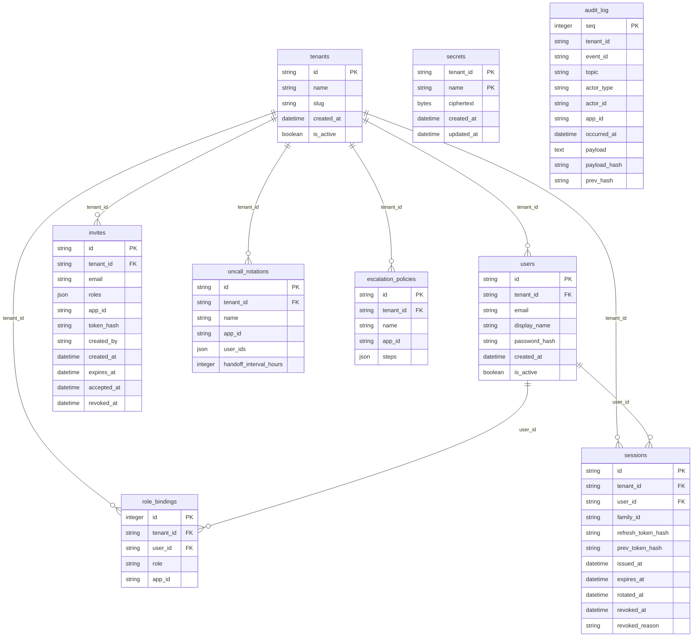
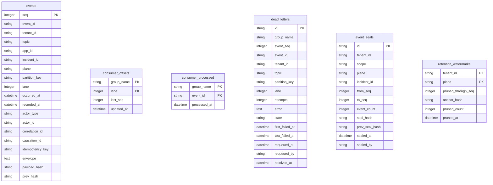
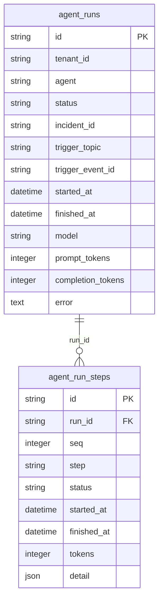

# 10 - Data design

Owner: engineering. Generated by `scripts/gen_erd.py` (`make erd`) from the
SQLAlchemy models Alembic also autogenerates migrations from, so this document
cannot drift from the schema. The design notes below are authored; the ERD and
the column tables are not.

Generated: 2026-08-31T21:10:01+00:00
Tables: 17

## 1. Entity relationship diagram

### Identity and security (S1)

Who the tenant is, who its people are, and the append-only record of what they did.

### Event backbone (S2)

The outbox and the log are one table: state and its event are written in the same transaction, and the same rows are what replay reads.

### Agent traces (S2, filled S5)

Written from Sprint 5 by the agent suite; shipped now so agents are born observable rather than instrumented afterwards.

## 2. Tables

### Identity and security (S1)

#### `tenants`

| Column | Type | Null | Notes |
|---|---|---|---|
| `id` | string | no | primary key |
| `name` | string | no |  |
| `slug` | string | no | unique |
| `created_at` | datetime | no |  |
| `is_active` | boolean | no |  |

Constraints: unique (slug)

#### `users`

| Column | Type | Null | Notes |
|---|---|---|---|
| `id` | string | no | primary key |
| `tenant_id` | string | no | -> tenants.id |
| `email` | string | no |  |
| `display_name` | string | no |  |
| `password_hash` | string | no |  |
| `created_at` | datetime | no |  |
| `is_active` | boolean | no |  |

Indexes: `ix_users_tenant_id`  
Constraints: unique (tenant_id, email)

#### `role_bindings`

| Column | Type | Null | Notes |
|---|---|---|---|
| `id` | integer | no | primary key |
| `tenant_id` | string | no | -> tenants.id |
| `user_id` | string | no | -> users.id |
| `role` | string | no |  |
| `app_id` | string | yes |  |

Indexes: `ix_role_bindings_tenant_user`  
Constraints: unique (tenant_id, user_id, role, app_id)

#### `invites`

| Column | Type | Null | Notes |
|---|---|---|---|
| `id` | string | no | primary key |
| `tenant_id` | string | no | -> tenants.id |
| `email` | string | no |  |
| `roles` | json | no |  |
| `app_id` | string | yes |  |
| `token_hash` | string | no | unique |
| `created_by` | string | no |  |
| `created_at` | datetime | no |  |
| `expires_at` | datetime | no |  |
| `accepted_at` | datetime | yes |  |
| `revoked_at` | datetime | yes |  |

Indexes: `ix_invites_tenant_id`  
Constraints: unique (token_hash)

#### `sessions`

| Column | Type | Null | Notes |
|---|---|---|---|
| `id` | string | no | primary key |
| `tenant_id` | string | no | -> tenants.id |
| `user_id` | string | no | -> users.id |
| `family_id` | string | no |  |
| `refresh_token_hash` | string | no | unique |
| `prev_token_hash` | string | yes |  |
| `issued_at` | datetime | no |  |
| `expires_at` | datetime | no |  |
| `rotated_at` | datetime | yes |  |
| `revoked_at` | datetime | yes |  |
| `revoked_reason` | string | yes |  |

Indexes: `ix_sessions_prev_token_hash`, `ix_sessions_tenant_family`, `ix_sessions_tenant_id`  
Constraints: unique (refresh_token_hash)

#### `oncall_rotations`

| Column | Type | Null | Notes |
|---|---|---|---|
| `id` | string | no | primary key |
| `tenant_id` | string | no | -> tenants.id |
| `name` | string | no |  |
| `app_id` | string | yes |  |
| `user_ids` | json | no |  |
| `handoff_interval_hours` | integer | no |  |

Indexes: `ix_oncall_rotations_tenant_id`

#### `escalation_policies`

| Column | Type | Null | Notes |
|---|---|---|---|
| `id` | string | no | primary key |
| `tenant_id` | string | no | -> tenants.id |
| `name` | string | no |  |
| `app_id` | string | yes |  |
| `steps` | json | no |  |

Indexes: `ix_escalation_policies_tenant_id`

#### `secrets`

| Column | Type | Null | Notes |
|---|---|---|---|
| `tenant_id` | string | no | primary key |
| `name` | string | no | primary key |
| `ciphertext` | bytes | no |  |
| `created_at` | datetime | no |  |
| `updated_at` | datetime | no |  |

#### `audit_log`

| Column | Type | Null | Notes |
|---|---|---|---|
| `seq` | integer | no | primary key |
| `tenant_id` | string | no |  |
| `event_id` | string | no | unique |
| `topic` | string | no |  |
| `actor_type` | string | no |  |
| `actor_id` | string | no |  |
| `app_id` | string | yes |  |
| `occurred_at` | datetime | no |  |
| `payload` | text | no |  |
| `payload_hash` | string | no |  |
| `prev_hash` | string | yes |  |

Indexes: `ix_audit_log_tenant_seq`  
Constraints: unique (event_id)

### Event backbone (S2)

#### `events`

| Column | Type | Null | Notes |
|---|---|---|---|
| `seq` | integer | no | primary key |
| `event_id` | string | no | unique |
| `tenant_id` | string | no |  |
| `topic` | string | no |  |
| `app_id` | string | yes |  |
| `incident_id` | string | yes |  |
| `plane` | string | no |  |
| `partition_key` | string | no |  |
| `lane` | integer | no |  |
| `occurred_at` | datetime | no |  |
| `recorded_at` | datetime | no |  |
| `actor_type` | string | no |  |
| `actor_id` | string | no |  |
| `correlation_id` | string | yes |  |
| `causation_id` | string | yes |  |
| `idempotency_key` | string | yes |  |
| `envelope` | text | no |  |
| `payload_hash` | string | no |  |
| `prev_hash` | string | yes |  |

Indexes: `ix_events_causation`, `ix_events_chain`, `ix_events_incident`, `ix_events_lane_seq`, `ix_events_tenant_id`, `ix_events_tenant_seq`, `ix_events_topic`  
Constraints: unique (event_id)

#### `consumer_offsets`

| Column | Type | Null | Notes |
|---|---|---|---|
| `group_name` | string | no | primary key |
| `lane` | integer | no | primary key |
| `last_seq` | integer | no |  |
| `updated_at` | datetime | no |  |

#### `consumer_processed`

| Column | Type | Null | Notes |
|---|---|---|---|
| `group_name` | string | no | primary key |
| `event_id` | string | no | primary key |
| `processed_at` | datetime | no |  |

#### `dead_letters`

| Column | Type | Null | Notes |
|---|---|---|---|
| `id` | string | no | primary key |
| `group_name` | string | no |  |
| `event_seq` | integer | no |  |
| `event_id` | string | no |  |
| `tenant_id` | string | no |  |
| `topic` | string | no |  |
| `partition_key` | string | no |  |
| `lane` | integer | no |  |
| `attempts` | integer | no |  |
| `error` | text | no |  |
| `state` | string | no |  |
| `first_failed_at` | datetime | no |  |
| `last_failed_at` | datetime | no |  |
| `requeued_at` | datetime | yes |  |
| `requeued_by` | string | yes |  |
| `resolved_at` | datetime | yes |  |

Indexes: `ix_dead_letters_group_state`, `ix_dead_letters_tenant_state`

#### `event_seals`

| Column | Type | Null | Notes |
|---|---|---|---|
| `id` | string | no | primary key |
| `tenant_id` | string | no |  |
| `scope` | string | no |  |
| `plane` | string | no |  |
| `incident_id` | string | yes |  |
| `from_seq` | integer | no |  |
| `to_seq` | integer | no |  |
| `event_count` | integer | no |  |
| `seal_hash` | string | no |  |
| `prev_seal_hash` | string | yes |  |
| `sealed_at` | datetime | no |  |
| `sealed_by` | string | no |  |

Indexes: `ix_event_seals_tenant`, `ix_event_seals_tenant_id`

#### `retention_watermarks`

| Column | Type | Null | Notes |
|---|---|---|---|
| `tenant_id` | string | no | primary key |
| `plane` | string | no | primary key |
| `pruned_through_seq` | integer | no |  |
| `anchor_hash` | string | no |  |
| `pruned_count` | integer | no |  |
| `pruned_at` | datetime | no |  |

### Agent traces (S2, filled S5)

#### `agent_runs`

| Column | Type | Null | Notes |
|---|---|---|---|
| `id` | string | no | primary key |
| `tenant_id` | string | no |  |
| `agent` | string | no |  |
| `status` | string | no |  |
| `incident_id` | string | yes |  |
| `trigger_topic` | string | yes |  |
| `trigger_event_id` | string | yes |  |
| `started_at` | datetime | no |  |
| `finished_at` | datetime | yes |  |
| `model` | string | yes |  |
| `prompt_tokens` | integer | no |  |
| `completion_tokens` | integer | no |  |
| `error` | text | yes |  |

Indexes: `ix_agent_runs_incident`, `ix_agent_runs_tenant_id`, `ix_agent_runs_tenant_started`

#### `agent_run_steps`

| Column | Type | Null | Notes |
|---|---|---|---|
| `id` | string | no | primary key |
| `run_id` | string | no | -> agent_runs.id |
| `seq` | integer | no |  |
| `step` | string | no |  |
| `status` | string | no |  |
| `started_at` | datetime | no |  |
| `finished_at` | datetime | yes |  |
| `tokens` | integer | no |  |
| `detail` | json | no |  |

Indexes: `ix_agent_run_steps_run`, `ix_agent_run_steps_run_id`

## 3. Retention planes

Two planes share one table and are told apart by the `plane` column.

| Plane | Contents | Lifetime | Sealed |
|---|---|---|---|
| `signal` | telemetry: metric samples, health polls, alerts, connector health | configured window, default 7 days, bounded 1-90 by the domain | no |
| `incident` | what an incident was: declarations, evidence, decisions, actions, communications | kept | yes |

Retention is the only code path that removes a recorded event
(`application/events/retention.py`). `RetentionPolicy.applies_to` has no branch
that can return true for the incident plane, and `SqlEventStore.prune` raises on
any plane but signal, so the two rules are enforced twice and neither is
configurable.

## 4. The hash chain and its anchors

Each event carries `payload_hash` (canonical sha256 of the payload, defined by
the frozen envelope contract) and `prev_hash` (the payload hash of the previous
event in the same chain). Chains are per **(tenant, plane)**: a single chain
across both planes would be broken by the first retention prune.

Pruning writes a row to `retention_watermarks` holding the payload hash of the
last event removed. Verification of the survivors starts from that anchor, which
is what distinguishes a prune (anchored, expected) from a deletion (unanchored,
detected). `event_seals` closes a range: the ordered `(seq, event_id,
payload_hash, prev_hash)` tuples are hashed together with the tenant's previous
seal, so seals chain onto each other and re-sealing a doctored range cannot
reproduce the original hash.

Because `prev_hash` points at a payload hash, two adjacent events with identical
payloads produce identical links; the seal is what binds position and identity,
and it is what an audit checks against.

## 5. Ordering and offsets

`events.lane` is assigned at write time from `blake2b(partition_key) % 16`
(`domain/events/lanes.py`). It is stored rather than computed on read because
the mapping must be identical across processes and restarts - Python's built-in
`hash()` is salted per process, and disagreement about a lane is silent
reordering. Each `(group, lane)` pair owns a row in `consumer_offsets`, so one
slow or dead-lettered partition never blocks another. Changing the lane count
re-shards the bus and needs a migration that recomputes every `lane` value.

`consumer_processed` is the idempotency ledger: `(group, event_id)`. The handler,
its ledger row and the offset advance commit in one transaction, so a crash
mid-delivery redelivers the event against unchanged state.

## 6. Tenant isolation

Every table that holds customer data carries `tenant_id`, and the predicate is
applied inside the repository rather than by handlers (REQ-013). Two paths are
deliberately cross-tenant and documented at their definitions:

- `EventStore.read_for_dispatch` - one dispatcher serves the whole install; it
  hands handlers a full envelope carrying `tenant_id`, and handler writes go
  through tenant-scoped repositories.
- `EventStore.tenants` - the retention sweep's work list.

`_platform` is a reserved tenant id used for events about the platform itself
(connector health). Because replay is tenant-scoped, no customer can read them.

## 7. Indexes

Every index exists for a query the platform actually makes:

| Index | Serves |
|---|---|
| `ix_events_tenant_seq` | replay paging (`tenant_id`, `seq > after_seq`) |
| `ix_events_chain` | chain verification and sealing per (tenant, plane) |
| `ix_events_lane_seq` | the dispatcher's per-lane sweep |
| `ix_events_incident` | incident-scoped timelines and seals |
| `ix_events_topic` | topic-filtered replay |
| `ix_events_causation` | causal-chain walks |
| `ix_dead_letters_tenant_state` | the operator's dead-letter pane |
| `ix_dead_letters_group_state` | the dispatcher draining requeues |
| `ix_audit_log_tenant_seq` | audit chain verification |

## 8. Portability

SQLite in WAL mode today, Postgres by connection string: only portable column
types are used, `TZDateTime` re-attaches UTC on load because SQLite drops
tzinfo, and JSON columns hold small value objects rather than anything queried
relationally. Two behaviours are SQLite-specific and named here so a Postgres
move is deliberate rather than surprising:

1. `events.seq` is an autoincrement integer primary key. On Postgres this
   becomes a sequence; gaps from rolled-back transactions are already tolerated
   by every reader, which treats `seq` as ordering, not as a count.
2. The chain tip is read and written inside one transaction. SQLite serialises
   writers, so this is safe; Postgres needs an explicit lock or a unique
   constraint on `(tenant_id, plane, prev_hash)` to keep two concurrent
   appenders from claiming the same predecessor.
