# 24 - Onboarding an application, step by step

Owner: engineering. Status: complete.

This is the operator's walkthrough of getting one application from "nothing knows
about it" to "SignalForge is watching it". Every screenshot below was captured
from the running product by `playbook/design/capture-onboarding.cjs`, at
1440 wide, against a real signed-in session. If a picture disagrees with what you
see, the picture is wrong and the product is right.

`docs/23-user-guide.md` is the shorter version and covers what happens *after*
onboarding. This document is only the onboarding path, at full length.

---

## What onboarding actually is

SignalForge learns an application through two public contracts and nothing else.
No plugin is written, no core code changes, no application is special-cased.

| Direction | Contract | What it is |
|---|---|---|
| SignalForge calls you | `/observe/*` - twelve paths | metrics, logs, traces, health, topology, the action manifest and its execution, the chaos manifest and its injection |
| You call SignalForge | `/api/v1/ingest/*` - five paths | changes, alerts, topology, messages, tickets - each signed with an HMAC |

The exact shapes are in `docs/11-api-spec.md`; the frozen definitions are
`signalforge/contracts/observe.py` and `signalforge/contracts/ingest.py`.

You do not have to serve all of it. An application that serves only
`/observe/metrics` and `/observe/health` can be detected on and probed; it just
cannot have its logs read or an action run on it. **A Spring Boot application
with Micrometer on its classpath serves enough already and can be onboarded with
no changes at all** - see [the no-change path](#the-no-change-path-spring-boot)
at the end.

## Before you start

- The application answers on an absolute `http(s)` base URL that the SignalForge
  node can reach. No query, no fragment.
- You hold `manage_apps`. The Org Owner role holds it; so does anyone you have
  granted it to in the role matrix.
- You have chosen the **app id**. It is permanent - roles, connectors, ingest
  keys, events and the audit chain are all scoped by it - and everything else on
  the Basics screen can be corrected later.

---

## Step 0 - Get in

`bash run.sh` (on Windows without bash, `run.cmd`) prints the URLs. The cockpit is at `http://127.0.0.1:3000` unless
`SIGNALFORGE_WEB_PORT` says otherwise (if something else already holds 3000 -
Grafana, for example - run.sh will have been started on another port and printed
it).

The first person to sign up creates the organisation and becomes its Org Owner.
Everybody else arrives by invitation.

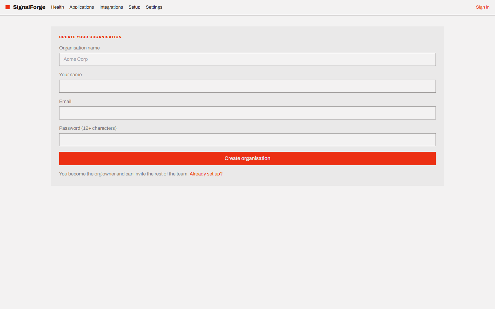

Afterwards you sign in with three things, not two: the organisation slug, your
email, and your password. The slug is what scopes the session to a tenant.

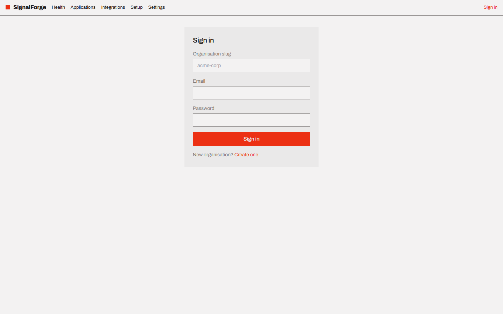

## Step 0.5 - Set the organisation up

**Setup** in the top bar. Nothing here blocks onboarding, and all of it blocks a
useful *incident*: paging walks the on-call rotations and escalation policies
configured on this screen, and an unanswered page escalates through them on its
own.

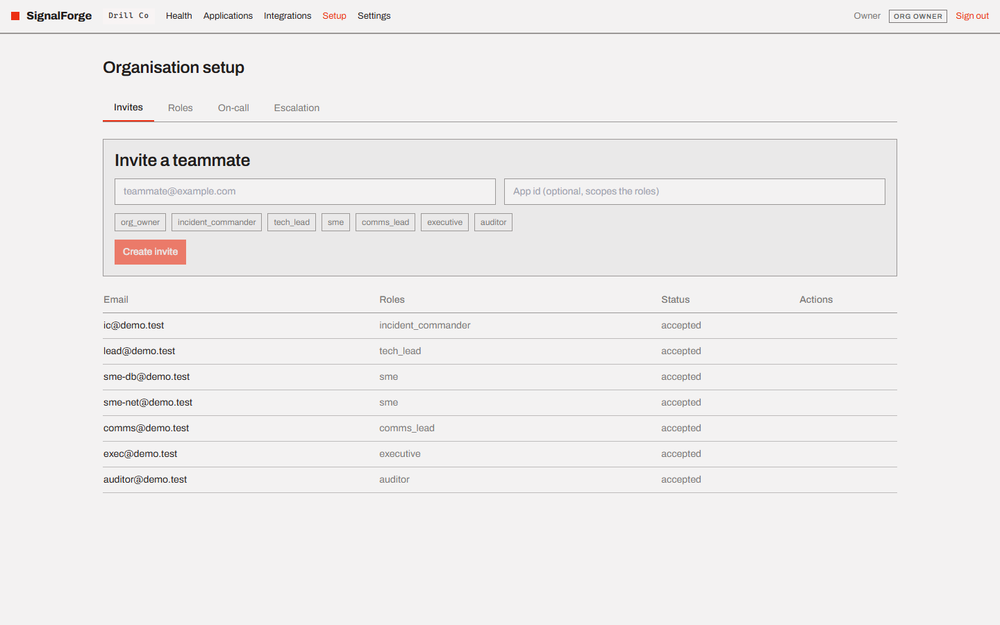

Invite the people an incident needs, with roles attached:

| Role | Can |
|---|---|
| Org Owner | manage the org, apps, policies and integrations; read the audit |
| Incident Commander | declare, change severity, approve high-risk actions, close |
| Tech Lead | declare, change severity, approve high-risk actions |
| SME | investigate and answer pages - deliberately holds no permissions |
| Comms Lead | approve customer communications |
| Executive | approve executive communications, and nothing operational |
| Auditor | read the record. Nothing else, ever. |

## Step 0.9 - Register the application

**Applications → Onboard an application**. The form asks for the app id, a
display name, tier, environment, base URL and owning team. Saving it registers
the application and drops you straight into the wizard at step 2, because
registering and onboarding are one motion rather than two.

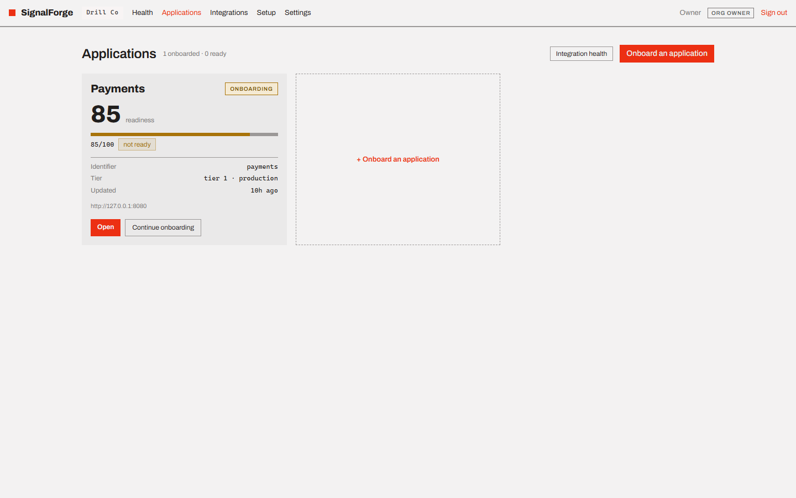

The card shows the readiness score and an `onboarding` / `ready` badge. In the
picture, Payments sits at 85 and still reads *not ready* - which is the whole
point of the scoring rule, explained under [step 7](#7-test---5-points).

---

## The seven steps, and what each one is worth

The wizard is seven routes, not seven tabs: `/apps/{app-id}/onboard/1` through
`/7`. A half-finished onboarding is a URL you can send to whoever holds the
credential for step 2. Nothing is staged across steps - each step writes its own
section through its own endpoint, and the whole application is re-read
afterwards, because the domain is allowed to refuse or adjust what a step sent.

Readiness is thirteen weighted checks summing to exactly 100, evaluated in
`signalforge/domain/onboarding/readiness.py`. The stepper across the top of every
wizard screen shows the per-step split off the same numbers, so the cockpit can
never call something ready that the platform would not.

| Check | Step | Weight | Blocking |
|---|---|---:|---|
| Application base URL | basics | 10 | **yes** |
| At least one integration | connect | 10 | **yes** |
| Integrations answering | connect | 10 | **yes** |
| Golden signals mapped | map | 10 | **yes** |
| Business counters mapped | map | 5 | |
| Region label selected | map | 5 | |
| Journeys with probes | map | 10 | |
| Actions imported | map | 5 | |
| Topology imported | topology | 10 | |
| SLO targets | slos | 10 | **yes** |
| Severity matrix | slos | 5 | |
| Baselines learned | baseline | 5 | |
| End-to-end test passed | test | 5 | |

`ready` requires **every blocking check green *and* the score over the threshold
of 80**. The two conditions are independent on purpose.

---

### 1. Basics - 10 points, blocking

Who the application is and where it lives.

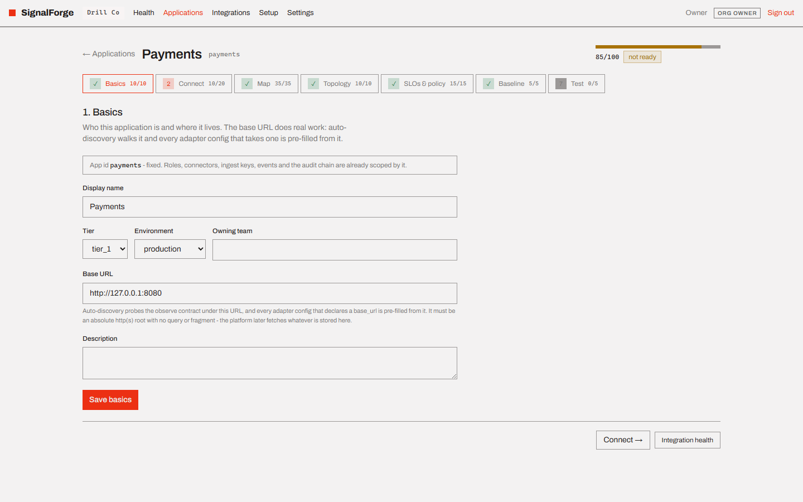

The **base URL does real work** and is the one field worth care: auto-discovery
walks it, every adapter config that declares a `base_url` is pre-filled from it,
and the platform later fetches whatever is stored here. The API refuses anything
that is not an absolute http(s) root, and the refusal is shown rather than
swallowed.

The app id is displayed and cannot be edited. Everything else can.

### 2. Connect - 20 points, 10 of them blocking

Bind the integrations. This is the longest screen in the product and the one
where onboarding usually stalls.

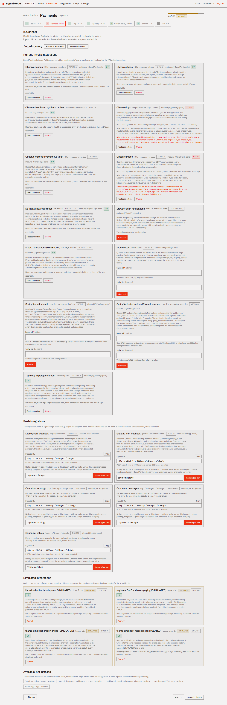

**Start with `Probe this application`.** Auto-discovery walks the observe
contract under the base URL, reports what answered, and pre-fills the cards
below. It sends no credential and writes no binding - findings are suggestions.
A `401` or `403` counts as *found*: a guarded endpoint is still an endpoint.

Then there are three genuinely different things to do, and the screen has a card
shape for each:

- **Pull and invoke** - SignalForge calls out. Give it config and a credential.
  The fields are rendered from the adapter's own manifest, which is also what the
  API validates against, so the form cannot drift from the contract. This is
  where `http-observe-metrics`, `http-observe-health`, `http-observe-logs`,
  `http-observe-traces`, `http-observe-actions`, `http-observe-chaos`,
  `prometheus`, `topo-import`, `kb-index` and the Spring Actuator pair live.
- **Push** - the application posts to SignalForge. Press `Issue ingest key`, copy
  the ingest URL, and hand the token to whoever is sending. **The token is shown
  once and masked everywhere afterwards.** Every push request carries
  `X-SignalForge-Signature` (hex HMAC-SHA256 over `<timestamp>.<raw body>`) and
  `X-SignalForge-Timestamp`, within a 300-second replay window; `event_id` is the
  idempotency unit, so duplicates are acknowledged rather than re-applied.
- **Simulated** - built in, nothing to configure, no credential to hold. Whatever
  they produce carries the `SIMULATED` marker for the rest of its life.

`Test every connector` runs a real connection test per binding, in its own
direction. **A failure here is a normal outcome, not an error in the wizard** -
in the screenshot, `http-observe-logs` and `http-observe-traces` read `DOWN` and
the card prints the actual validation error the application answered with. That
is the 2 of 15 that keeps this step at 10/20 and the whole application at *not
ready*.

The bottom section, **Available, not installed**, lists adapters whose interface
exists but whose runtime does not ship on this node. Binding one would buy an
`UNKNOWN` row and nothing else, so they are listed rather than offered.

### 3. Map - 35 points, 10 of them blocking

The largest single score in the wizard, because this is where the platform learns
what to look at.

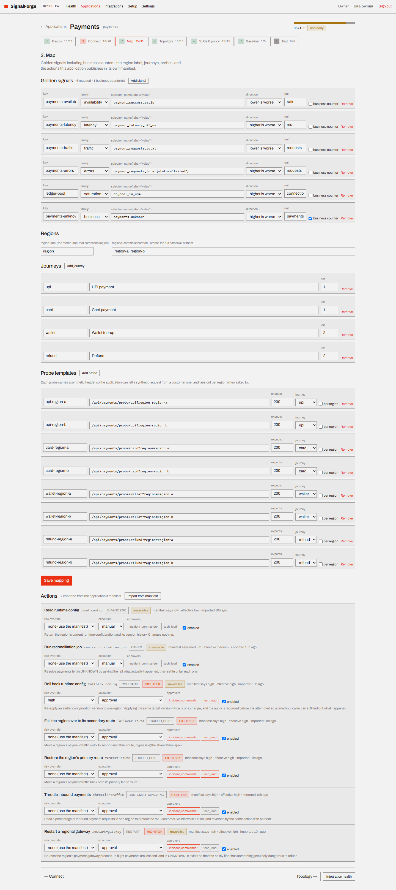

- **Golden signals.** One row per signal: a key, a family
  (availability / errors / latency / saturation / traffic / **business**), a
  selector in `name{label="value"}` form, a direction, a unit, and whether it is a
  business counter. Business is a first-class family here, not a special case:
  corroboration needs two independent families with one of them customer-facing,
  so an application mapped with only technical signals **can be watched but never
  corroborated**, and the screen warns you when no business counter is mapped.
- **Regions.** The metric label that carries the region, plus the region values.
  Probes fan out across all of them, and per-region health cannot be separated
  without the label.
- **Journeys.** Named user journeys with a tier. Severity is computed from journey
  tier, so this is not decoration.
- **Probe templates.** Path, method, expected status, timeout, the journey it
  belongs to, and whether it fans out per region. Each probe carries a synthetic
  header (`X-SignalForge-Synthetic`) so your application can tell a synthetic
  request from a customer one.
- **Actions.** Imported from the application's own `/observe/actions` manifest,
  with the risk class each action declares. You may raise a risk class here.
  **You may never lower one** - that refusal is in the domain, not the screen.

The whole mapping saves as one `PUT`, because the invariants cross the sections:
a probe names a journey, an SLO names a journey, and the domain needs the whole
document in hand to check them.

### 4. Topology - 10 points

Upload the dependency map as JSON: `nodes`, `edges`, and an optional `version`.

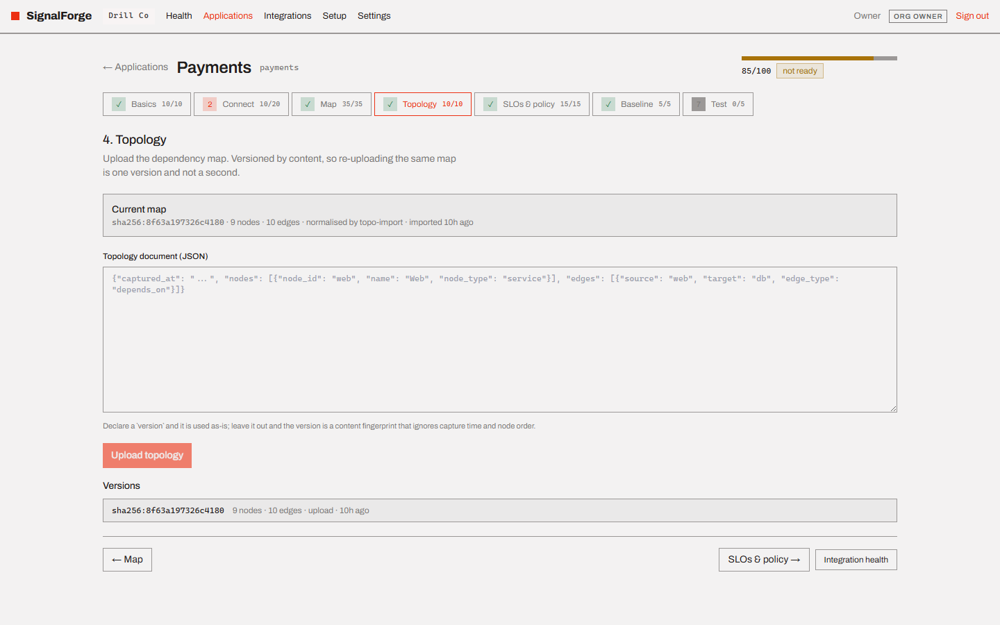

Two behaviours that surprise people if the screen does not say so, so it does:

- **The same content uploaded twice is one version.** Versioning is by content
  fingerprint and ignores capture time and node order, so a re-upload answers
  `unchanged` rather than quietly creating a second version.
- **A dangling edge rejects the whole document**, names the offending edges, and
  leaves the previous map intact. A half-imported topology would hand blast radius
  a map with holes in it.

Without a topology, blast radius has nothing to walk: you get the CONFIRMED list
(measured) and no PREDICTED list (inferred).

### 5. SLOs & policy - 15 points, 10 of them blocking

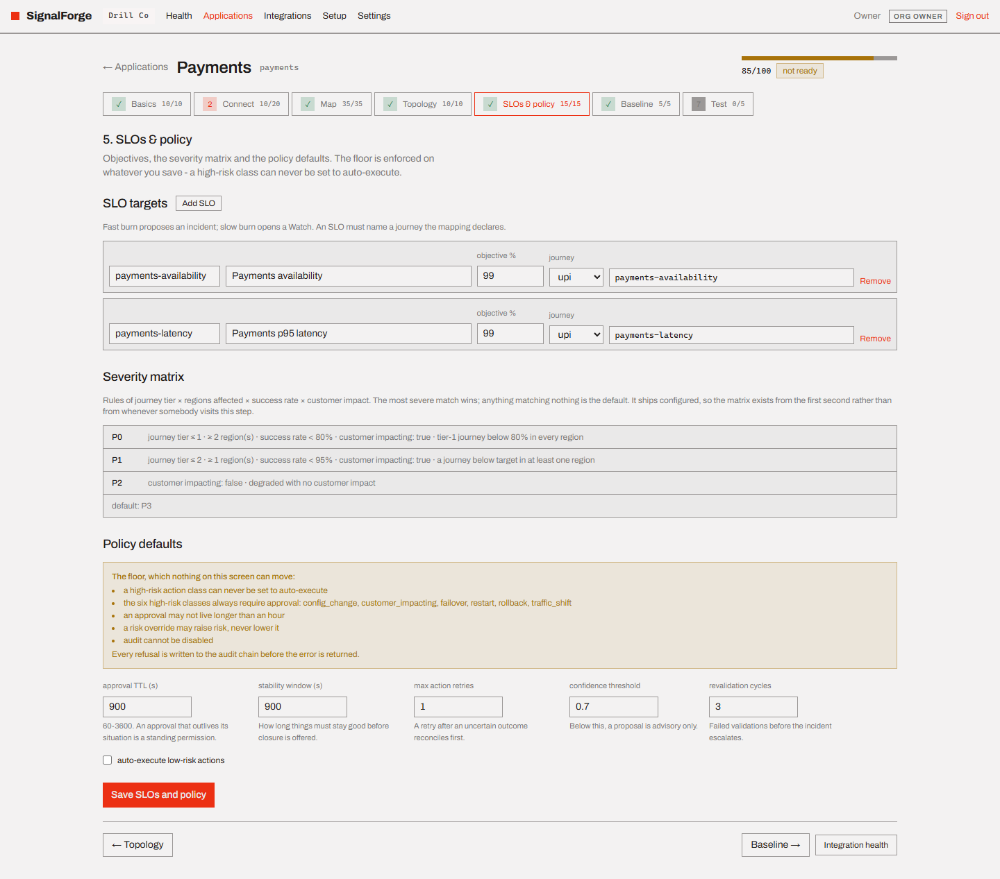

- **SLO targets.** Objective, window, the journey it covers, the indicator
  selector, and the two burn multipliers. Fast burn proposes an incident; slow
  burn opens a Watch. An SLO must name a journey the mapping declares.
- **Severity matrix.** Rules of journey tier × regions affected × success rate ×
  customer impact; the most severe match wins. It **ships configured**, so the
  matrix exists from the first second rather than from whenever somebody first
  visits this step.
- **Policy defaults.** Approval TTL, stability window, max retries, confidence
  threshold, revalidation cycles, and whether low-risk actions may auto-execute.

The screen states the floor rather than hiding the controls, because an operator
who cannot see the rule cannot design around it:

> a high-risk class can never be set to auto-execute · the six high-risk classes
> always require approval · an approval may not live longer than an hour · a risk
> override may raise risk, never lower it · audit cannot be disabled

The floor is enforced on the *merged* policy in the domain, so a partial edit
cannot widen it, and **the refusal is written to the audit chain before the 422
comes back**.

### 6. Baseline - 5 points

Learn what normal looks like. Pick a sample count (3-30) and press
`Learn baselines`.

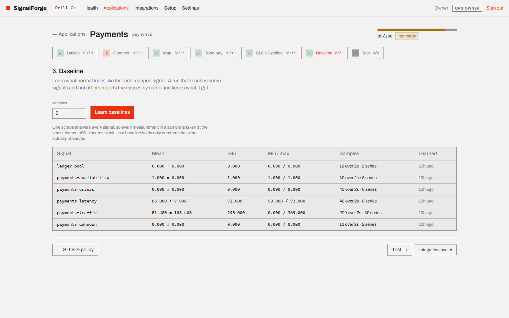

One scrape answers every signal, so every measurement in a sample is taken at the
same instant. p95 is nearest-rank, so a baseline holds only numbers that were
actually observed.

**Partial completion is designed, not accidental.** A run that reaches three of
five signals keeps the three, reports the other two by name with the reason, and
does not erase what an earlier run learned for them. A silently short baseline is
a detection bug three weeks later.

### 7. Test - 5 points

Every connector tested in its own direction, every journey probe run in every
declared region, and the readiness score recomputed from what came back.

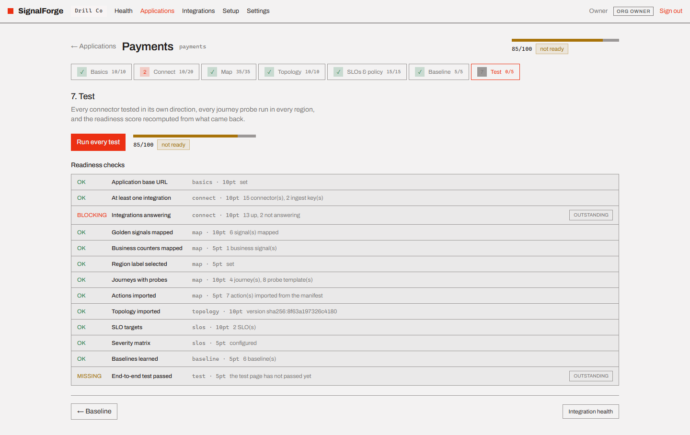

Four outcomes, kept as four things rather than collapsed into pass/fail:

| Outcome | Means |
|---|---|
| `passed` | it answered correctly |
| `failed` | it answered wrongly, or not at all |
| `pending` | a push connector with no traffic yet - **waiting, not broken** |
| `skipped` | the adapter has no runtime on this node |

The readiness list underneath is the whole scoring rule, in the open: each check
with its step, its weight, whether it passed, and why. Outstanding checks are
ordered blocking-first.

**This screenshot is the rule worth remembering.** The score reads 85, above the
threshold of 80, and the badge still reads *not ready* - because
`Integrations answering` is blocking and reports `13 up, 2 not answering`. A high
number can never buy its way past a red connector.

---

## After the wizard

The application page is what onboarding was for.

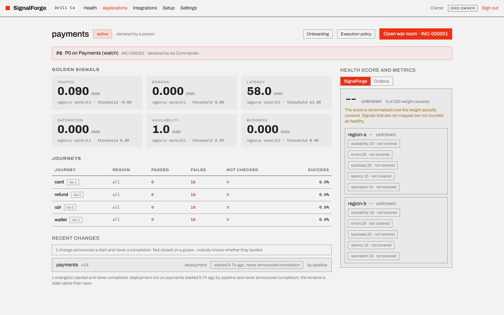

Six golden tiles with each reading against its threshold and the worst region
named, the journeys with per-region pass rates, recent changes with their change
window, and the health score broken down by region and by the weight each family
carries. The header carries a **stance** - Steady, Watch or Proposed - and, once
somebody has declared, the way into the war room.

Two honest notes about this particular capture: the application already carries a
declared incident from the demonstration drill, and its readings say `stale`
because the demo world's fault has since expired. A freshly onboarded, healthy
application shows the same layout reading Steady with live numbers. The health
score reads `unknown / 0 of 100 weight covered` when no signal has a fresh
reading to contribute - the score is renormalised over the weight actually
covered rather than counting unmapped or stale signals as healthy.

`Execution policy` on that header opens the per-application policy, which is
worth reading once even if you never edit it. It restates every action imported
at step 3 in plain language - what it does, its risk class, who may approve it,
how long that approval lives - and then names the six floor rules
(`FLOOR-HIGH-RISK-NO-AUTO`, `FLOOR-HIGH-RISK-APPROVER`,
`FLOOR-READ-ONLY-NO-MUTATE`, `FLOOR-RISK-NEVER-LOWERED`,
`FLOOR-APPROVAL-TTL-CAP`, `FLOOR-AUDIT-IMMUTABLE`) that the rows in red are
pinned by. `Dry run` shows what a document would do before it becomes a version,
and editing while an incident is open warns you that it invalidates approvals
already granted under the current version.

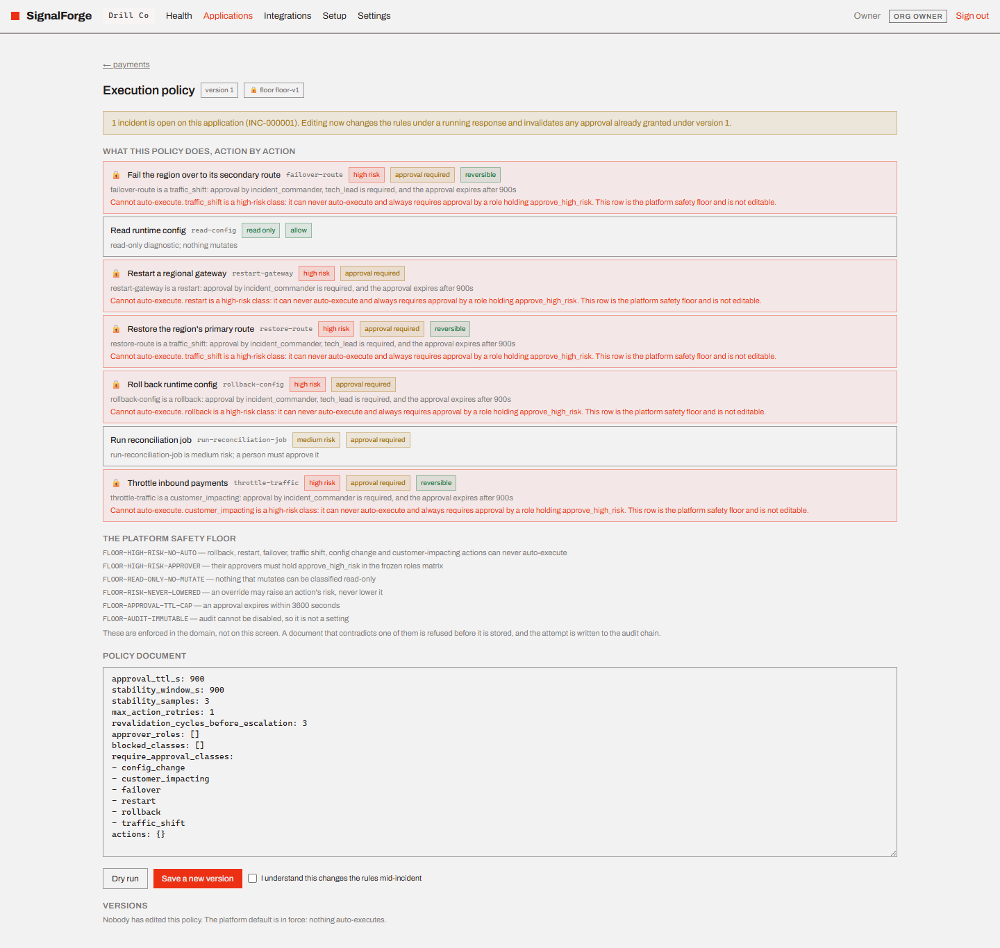

**Integrations** in the top bar is the estate-wide view of every binding, with a
`n needing attention` count in the header. A pull integration is measured by when
SignalForge last read it; a push integration by when something last arrived,
because SignalForge is the server for those and a reachability check would report
a sender that died last week as healthy. Failing rows carry the consecutive
failure count and the exact error - in the capture, the same two observe
endpoints that held step 2 at 10/20, with 215 consecutive failures and the
contract violation printed in full.

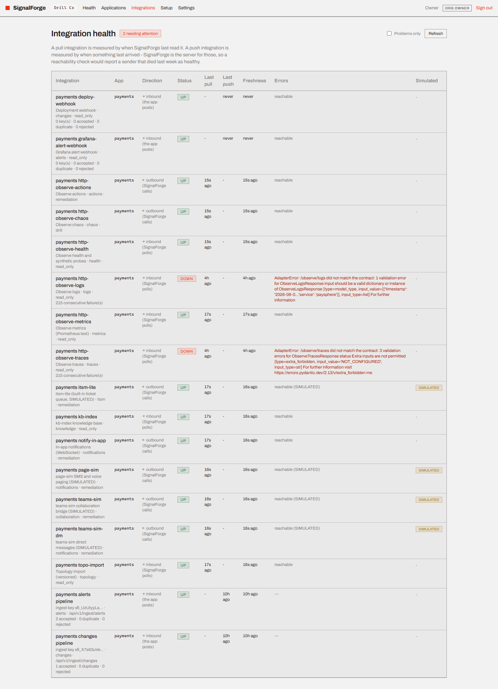

A dead connector is visible here; it does not take the cockpit down with it.

---

## The no-change path: Spring Boot

If the application has Micrometer on its classpath - most Boot services do - it
is already serving `/actuator/prometheus` and `/actuator/health`.

At step 2, bind **`spring-actuator-metrics`** and **`spring-actuator-health`**
with the application's base URL (or its management port, if management runs on
one) and **no credential**: Actuator is unauthenticated by default, so those two
adapters ask for none.

That gives you metrics, the health of every indicator the application registers,
and synthetic probes - enough for detection, the golden signals and journeys.

What it does **not** give you is logs, actions and chaos. Actuator has no log
search, no action manifest and no fault-injection surface, so no adapter can
offer them honestly. Bind the actuator pair to start seeing the application
today; serve `/observe/*` when you want SignalForge to read its logs or execute a
remediation on it.

---

## When it will not go green

| Symptom | Cause | Fix |
|---|---|---|
| `Probe this application` is disabled | no base URL | step 1 |
| Auto-discovery finds nothing | base URL wrong, or the app serves neither contract | check the URL from the SignalForge node, then consider the Actuator path |
| A connector reads `DOWN` with a validation error | the endpoint answered, but not in the contract's shape | the card prints the exact error - fix the payload, not the wizard |
| A push connector reads `pending` forever | nobody is posting yet | send one signed request; `pending` is not a failure |
| Score is high, badge says *not ready* | a blocking check is red | the readiness list on step 7 is ordered blocking-first |
| Baseline learned fewer signals than mapped | some selectors matched nothing | the run names each miss with its reason |
| "watched but not corroborated" | only one signal family, or none customer-facing | map a business counter on step 3 |
| Policy save returns 422 | you tried to move the floor | the floor is permanent; the refusal is already in the audit chain |

## Doing it over the API instead

Every screen above is a thin client over a published route. Anything the wizard
does, a pipeline can do - the full shapes are in `docs/11-api-spec.md` and
`/docs` on the running API.

| Step | Route |
|---|---|
| register | `POST /apps` |
| 1. basics | `PATCH /apps/{app_id}` |
| 2. connect | `POST /apps/{app_id}/discover`, `POST /apps/{app_id}/connection-tests` |
| 3. map | `PUT /apps/{app_id}/mapping`, `POST /apps/{app_id}/actions/import` |
| 4. topology | `PUT /apps/{app_id}/topology` |
| 5. slos & policy | `PUT /apps/{app_id}/governance` |
| 6. baseline | `POST /apps/{app_id}/baseline` |
| 7. test | `POST /apps/{app_id}/test` |
| readiness, any time | `GET /apps/{app_id}/readiness` |

`drills/demo-setup.yaml`, played by `bash scripts/demo.sh`, drives exactly this
sequence over HTTP and is the worked example.
